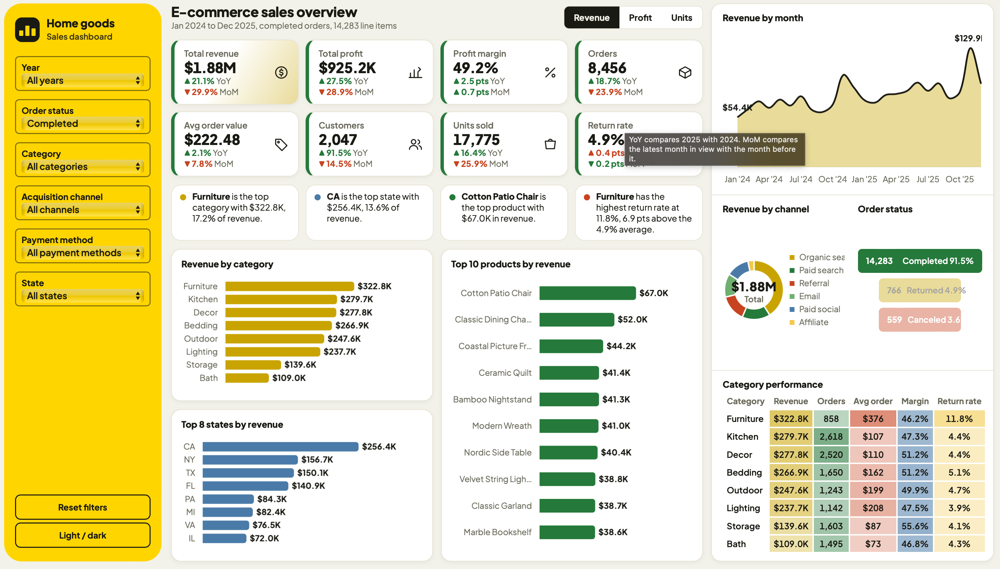
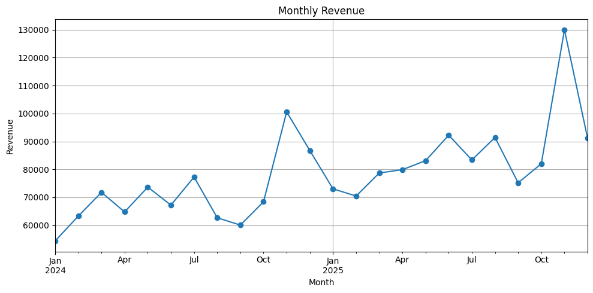

# E-Commerce Sales Analysis

Analysis of two years of online store data (January 2024 to December 2025) to understand revenue, profit, customer value and product returns, with an interactive sales dashboard.

  

*The preview shows all order statuses. The key findings below use completed orders only, which is the dashboard's default view.*

**Live dashboard:** https://bharath-0917.github.io/E-Commerce-sales-analysis/dashboard/

## Business questions
- How are revenue and profit changing over time?
- Which categories, products and states sell the most?
- Which acquisition channels bring the most valuable customers?
- Where are returns hurting the business?

## Data
Four related tables: customers (3,600), products (90), orders and order items (15,608 line items). Period: January 2024 to December 2025.

## Process
1. Checked each table for missing values and duplicates.
2. Removed duplicate orders and standardised category names.
3. Filled missing unit prices using each product's list price.
4. Merged the four tables into one dataset (`Cleaned_E-commerce_data.csv`).
5. Calculated revenue (quantity x price - discount), cost and profit.
6. Analysed completed orders only, then built the dashboard.

## Key findings (completed orders)
- Revenue is **$1.88M** with **$925K profit (49.2% margin)** from 8,456 orders. Including returned and canceled orders, revenue is $2.07M.
- Revenue grew **21%** from 2024 to 2025, and profit grew 27.5%.
- **November is the peak month** in both years (about $100K in 2024 and $130K in 2025), so the business is seasonal.
- **Furniture** earns the most revenue ($322.8K, 17.2%) and has the highest average order ($376, against $107 for Kitchen). It also has the lowest margin (46.2%) and by far the highest return rate (**11.8% vs 4.9% overall**).
- **Storage** has the highest margin (55.6%).
- **Referral** customers spend the most (about $1,105 each). **Paid social** customers spend about 40% less (about $649).
- **California** is the top state ($256.4K, 13.6% of revenue).
- The top product is **Cotton Patio Chair** ($67.0K).

## Analysis charts

## Dashboard features
- Filters for year, order status, category, acquisition channel, payment method and state
- Switch between revenue, profit and units sold
- KPI cards with year-over-year and month-over-month change
- Key insights that update with the filters
- Click a bar, slice or table row to filter the whole page
- Light and dark modes

## Recommendations
1. Investigate why Furniture is returned so often (damage, sizing or quality).
2. Invest more in referral and organic search.
3. Review paid social and affiliate spending.
4. Plan stock and campaigns early for November.

## Assumptions
- Revenue = quantity x unit price - discount.
- Profit does not include shipping fees.
- Return rate = returned items / all items.

## Repository contents
- `E-commerce Raw Data/`: the four original tables
- `Cleaned_E-commerce_data.csv`: the merged, cleaned dataset
- `E-Commerce-sales-analysis.ipynb`: cleaning and analysis notebook
- `dashboard/index.html`: the interactive dashboard
- Chart images and the dashboard preview

## Tools
Python (Pandas, Matplotlib), Google Colab, HTML and JavaScript (Chart.js) for the interactive dashboard.
